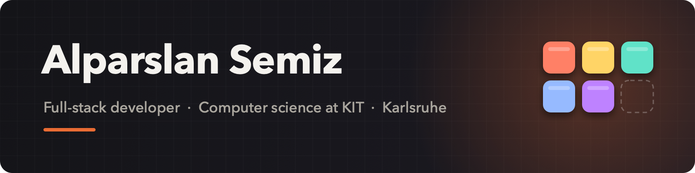

  

  <a href="https://github.com/AlparslanSemiz"><picture><source media="(prefers-color-scheme: dark)" srcset="https://raw.githubusercontent.com/danielcranney/readme-generator/main/public/icons/socials/github-dark.svg"></picture></a>&nbsp;&nbsp;
  <a href="https://www.linkedin.com/in/alparslansemiz/"><picture><source media="(prefers-color-scheme: dark)" srcset="https://raw.githubusercontent.com/danielcranney/readme-generator/main/public/icons/socials/linkedin-dark.svg"></picture></a>

I'm a computer science student at KIT and a full-stack developer at [Traggert](https://traggert.com), a startup in Karlsruhe. Next to my studies I build software for [PionierGarage](https://pioniergarage.de), KIT's entrepreneurship club, and for [Delta](https://www.delta-karlsruhe.de/), a student consulting group. I also run the website and technical infrastructure of my brothers' law firm, [Semiz Hukuk Bürosu](https://semizlaw.com) in Istanbul.

Most of my own projects start with a real problem. My father plans his course's timetable by hand every term, so I wrote him [Mozaik](https://github.com/AlparslanSemiz/Mozaik). My inbox was too full, so a bot now sorts it for me. When the Mac utilities I relied on stopped working, I wrote my own. I like tools that are small, fast and do one job well.

### 🧰 Tools

| | Project | What it does |
|---|---|---|
| ⌨️ | **[Şerit](https://github.com/AlparslanSemiz/Serit)** | Touch Bar app for MacBook Pro: Dock with badges, now playing (YouTube Music too), volume, brightness, weather and your next event. Recovers on its own when macOS takes the Touch Bar away. |
| 👋 | **[Veda](https://github.com/AlparslanSemiz/Veda)** | Quits a Mac app when you close its last window, the way Windows does. |
| 🌙 | **[Prayer Times Widget](https://github.com/AlparslanSemiz/prayer-times-widget)** | Prayer times widget for macOS and iOS, for wherever you are. One network request a day. |
| 🕹️ | **[Godot Mobile Template](https://github.com/AlparslanSemiz/godot-mobile-template)** | Starting point for mobile games in Godot 4.7, with headless tests and smoke runs in CI. |

### 🌐 Web apps

| | Project | What it does |
|---|---|---|
| 🧩 | **[Mozaik](https://github.com/AlparslanSemiz/Mozaik)** | Offline school timetable builder in a single HTML file, in five languages. 600+ commits. [Try it](https://alparslansemiz.github.io/Mozaik/) |
| 🎮 | **[GameMetrix](https://github.com/AlparslanSemiz/Gamemetrix)** | Collects game scores from many sources and weights them by reliability. [gamemetrix.me](https://gamemetrix.me) |
| ⚖️ | **[Semiz Hukuk Bürosu](https://semizlaw.com)** | Website and technical infrastructure I run for my brothers' law firm in Istanbul. |

### 🤖 Automation

| | Project | What it does |
|---|---|---|
| 📬 | **[Mail Triage Bot](https://github.com/AlparslanSemiz/mail-triage-bot)** | Gemini sorts new Outlook mail. Telegram sends urgent alerts and a digest twice a day. |
| 🏷️ | **[Price Sniper](https://github.com/AlparslanSemiz/price-sniper)** | Watches electronics prices on Geizhals.de and Kleinanzeigen.de and alerts on drops. |

### 🤝 Team projects

| | Project | What it is |
|---|---|---|
| 🎓 | **[RateMyProf](https://github.com/AlparslanSemiz/rate-my-professor)** | KIT professor-rating platform with an Android app, a Spring Boot API and a React admin panel. Team of 6. I built the admin panel, wrote backend tests and fixes, and set up the server and Docker deployment. |
| 📚 | **I Am In The Library** | Social app that shows which friends are in the library, with geofenced check-ins. React Native, Supabase, PostGIS. Team of 3. |
| 🧾 | **[InvoiceFlow](https://github.com/AlparslanSemiz/InvoiceFlow)** | Delta's internal invoicing app with PDF export and Factur-X XML. Team of 3. |
| 🌲 | **[Lost Soul](https://github.com/AlparslanSemiz/lost-soul)** | Dark-and-light platformer from a 3-day hackathon at KIT. Team of 4. I was the gameplay programmer. |

### 👷 Recently updated

<!-- RECENT:START -->
| Project | What it is | Updated |
|---|---|---|
| **[GameMetrix](https://github.com/AlparslanSemiz/Gamemetrix)** | Game scores from many sources, weighted by reliability. FastAPI and PostgreSQL backend with a server-rendered React frontend. | today |
| **[RateMyProf](https://github.com/AlparslanSemiz/rate-my-professor)** | KIT professor-rating platform (PSE team project): Android app, Spring Boot 4 backend and React admin panel with audit log and undo. | today |
| **[Prayer Times Widget](https://github.com/AlparslanSemiz/prayer-times-widget)** | Prayer times widget for macOS and iOS (ScriptWidget), with automatic location and the Diyanet method. | today |
| **[Şerit](https://github.com/AlparslanSemiz/Serit)** | Touch Bar app for MacBook Pro that recovers on its own: dock, now playing (YouTube Music too), volume, brightness, weather. A Pock alternative. | today |
| **[Veda](https://github.com/AlparslanSemiz/Veda)** | Quits a Mac app when you close its last window. Menu bar app for macOS. | today |
<!-- RECENT:END -->

### 🔧 Stack

`Java` `TypeScript` `Python` `SQL` `Swift` `Dart` · `React` `Next.js` `tRPC` `Expo` `Android` `Flutter` `Spring Boot` `FastAPI` `Godot` · `PostgreSQL` `Prisma` `Supabase` `Docker`

### 📫 How to reach me

- CV: <https://alparslansemiz.github.io>
- LinkedIn: <https://www.linkedin.com/in/alparslansemiz/>
- Email: alparslansemiz@outlook.com
