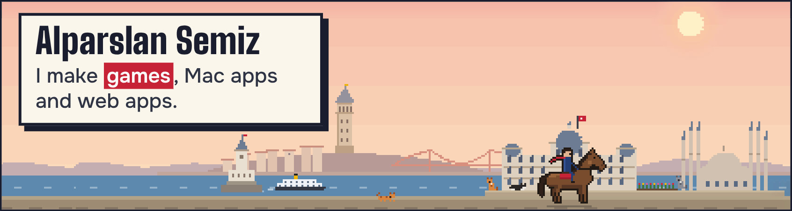

  <a href="https://alparslansemiz.com">&nbsp;<b>Website</b></a> &nbsp;·&nbsp;
  <a href="https://alparslansemiz.github.io">&nbsp;CV</a> &nbsp;·&nbsp;
  <a href="https://www.linkedin.com/in/alparslansemiz/">&nbsp;LinkedIn</a> 
  <a href="https://plumkitegames.com">&nbsp;Plumkite&nbsp;Games</a> &nbsp;·&nbsp;
  <a href="https://www.instagram.com/semizalparslan/">&nbsp;Instagram</a>

I'm Alp, from Istanbul, studying computer science at [KIT](https://www.kit.edu). Most of what I build starts with a real problem: my father planned his school's timetable by hand, so I wrote him [Mozaik](https://github.com/AlparslanSemiz/Mozaik). When the Mac utilities I relied on broke, I wrote my own.

- **Now:** full-stack developer at [Traggert](https://traggert.com), a startup in Karlsruhe
- **Around KIT:** software for [Delta](https://www.delta-karlsruhe.de/) (student consulting), member of [PionierGarage](https://pioniergarage.de)
- **On the side:** small Godot games at my one-person studio [Plumkite Games](https://plumkitegames.com)

## Start here

<table>
<tr>
<td width="50%" valign="top">
<b><a href="https://github.com/AlparslanSemiz/Mozaik">Mozaik</a></b> &nbsp;01 · PRODUCT 
Offline school timetable builder in a single HTML file, in five languages. 1,200+ commits. 
<a href="https://mozaik.alparslansemiz.com"><b>Try it →</b></a>
</td>
<td width="50%" valign="top">
<b><a href="https://github.com/AlparslanSemiz/Gamemetrix">GameMetrix</a></b> &nbsp;02 · WEB APP 
Game scores from many sources, weighted by how reliable each source is. FastAPI, PostgreSQL, React. 
<a href="https://gamemetrix.me"><b>Open gamemetrix.me →</b></a>
</td>
</tr>
<tr>
<td width="50%" valign="top">
<b><a href="https://github.com/AlparslanSemiz/rate-my-professor">RateMyProf</a></b> &nbsp;03 · TEAM PROJECT 
KIT professor ratings: Android app, Spring Boot API, React admin panel. Team of 6; I built the admin panel and the deployment. 
<a href="https://demo.ratemyprofessor.dev"><b>Try the demo →</b></a>
</td>
<td width="50%" valign="top">
<b><a href="https://github.com/AlparslanSemiz/Serit">Şerit</a></b> &nbsp;04 · MAC APP 
Touch Bar app for MacBook Pro: Dock, now playing, volume, brightness, weather. Recovers on its own. 
<a href="https://github.com/AlparslanSemiz/Serit#install"><b>Install →</b></a>
</td>
</tr>
</table>

## More projects

**Mac & iOS**
- **[Veda](https://github.com/AlparslanSemiz/Veda):** quits a Mac app when you close its last window, the way Windows does.
- **[Kumanda](https://github.com/AlparslanSemiz/Kumanda):** use your Mac from the couch with a game controller.
- **[Prayer Times Widget](https://github.com/AlparslanSemiz/prayer-times-widget):** prayer times for wherever you are, on macOS and iOS.
- Şerit and Veda install with Homebrew from [my tap](https://github.com/AlparslanSemiz/homebrew-tap).

**Games**
- **[Blokaos](https://blokaos.plumkitegames.com):** block puzzle with five game modes, from Plumkite Games. Coming soon.
- **[Lost Soul](https://github.com/AlparslanSemiz/lost-soul):** dark-and-light platformer from a 3-day hackathon at KIT. Team of 4, I was the gameplay programmer.
- **[Godot Mobile Template](https://github.com/AlparslanSemiz/godot-mobile-template):** starting point for mobile games in Godot 4.7, with tests in CI.

**Team & client work**
- **[InvoiceFlow](https://github.com/AlparslanSemiz/InvoiceFlow):** Delta's invoicing app with PDF export and Factur-X XML. Team of 3; the code is private.
- **I Am In The Library:** shows which friends are in the library, with geofenced check-ins. React Native, Supabase, PostGIS. Team of 3; private.
- **[Semiz Hukuk Bürosu](https://semizlaw.com):** website and infrastructure for my brothers' law firm in Istanbul.

**Bots**
- **[Mail Triage Bot](https://github.com/AlparslanSemiz/mail-triage-bot):** Gemini sorts new Outlook mail; Telegram sends urgent alerts and a digest twice a day.
- **[Price Sniper](https://github.com/AlparslanSemiz/price-sniper):** watches electronics prices on Geizhals.de and Kleinanzeigen.de.

**Stack:** TypeScript, Java, Python, Swift, GDScript · React, Next.js, Spring Boot, FastAPI, Godot · PostgreSQL, Docker, Cloudflare

Every project, with a contact form: <a href="https://alparslansemiz.com">alparslansemiz.com</a>
